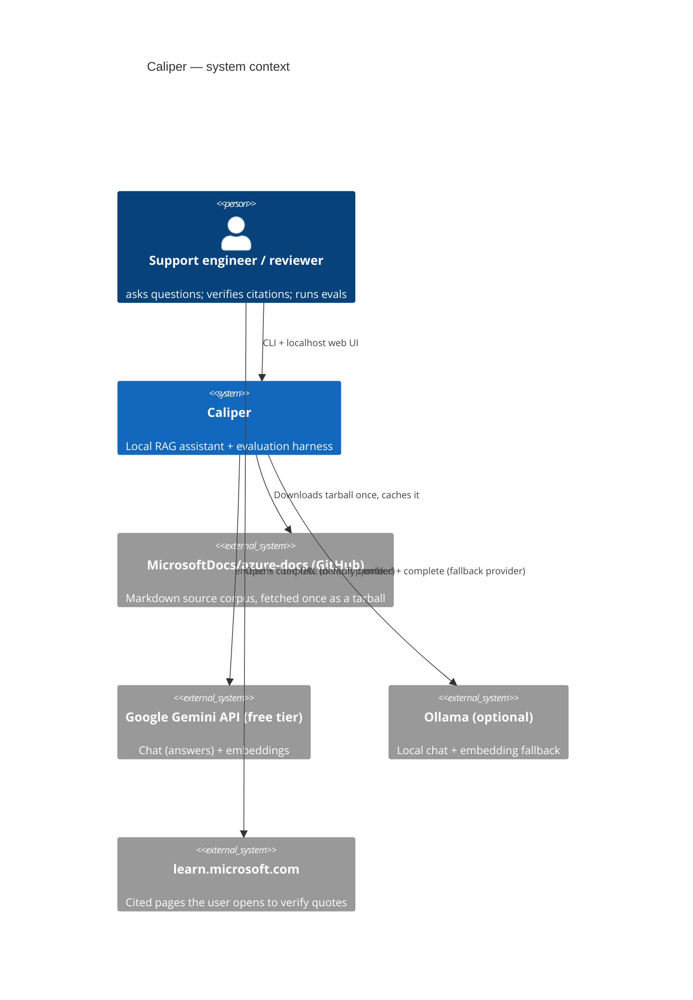
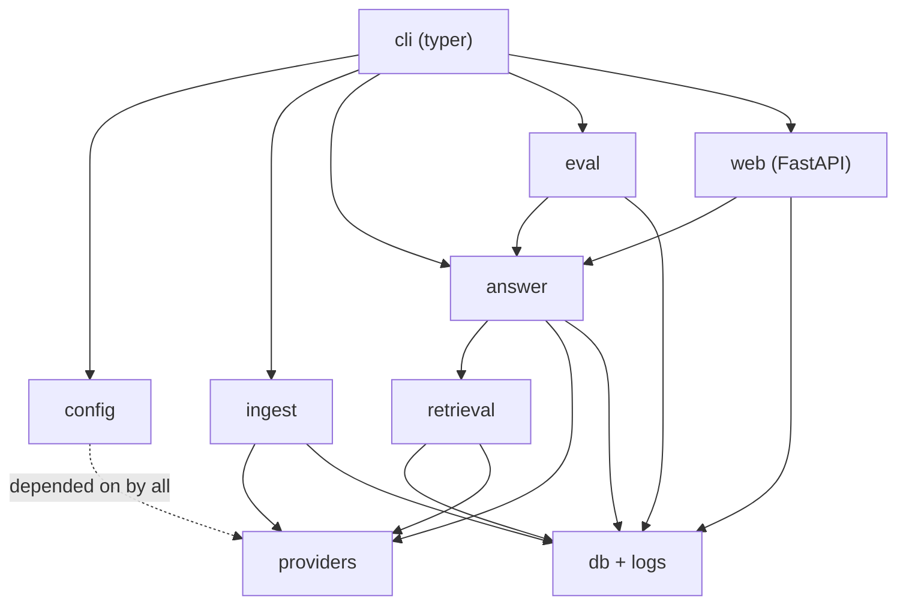
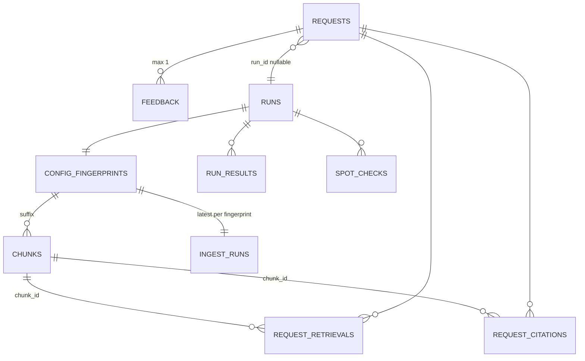
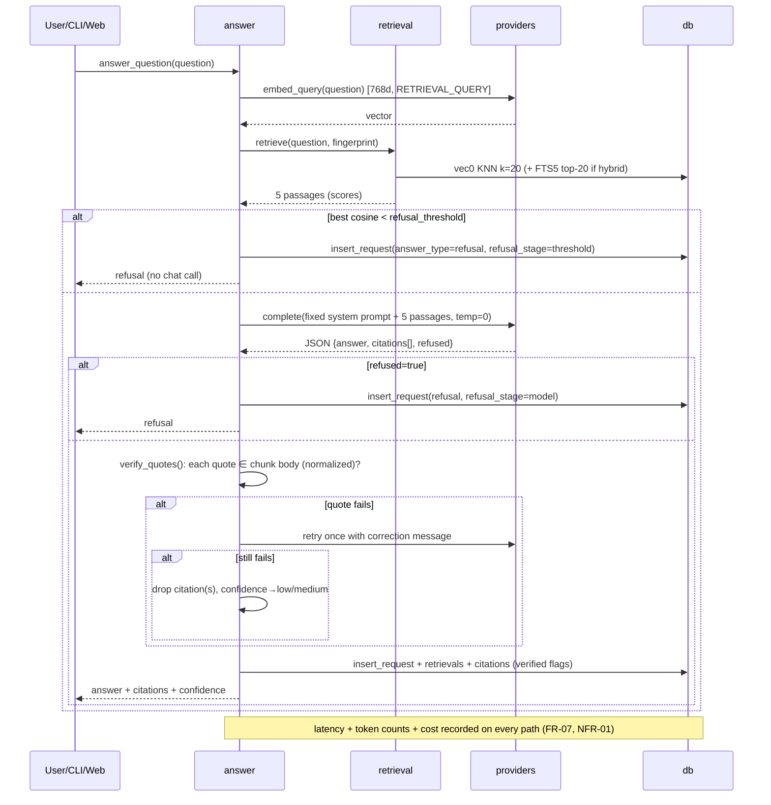
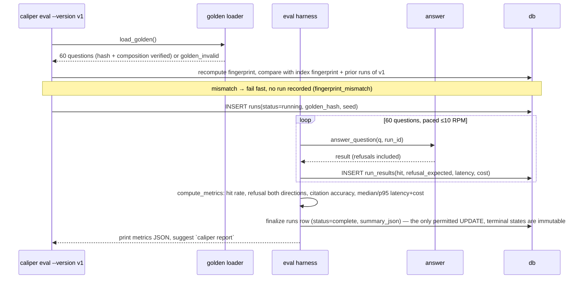
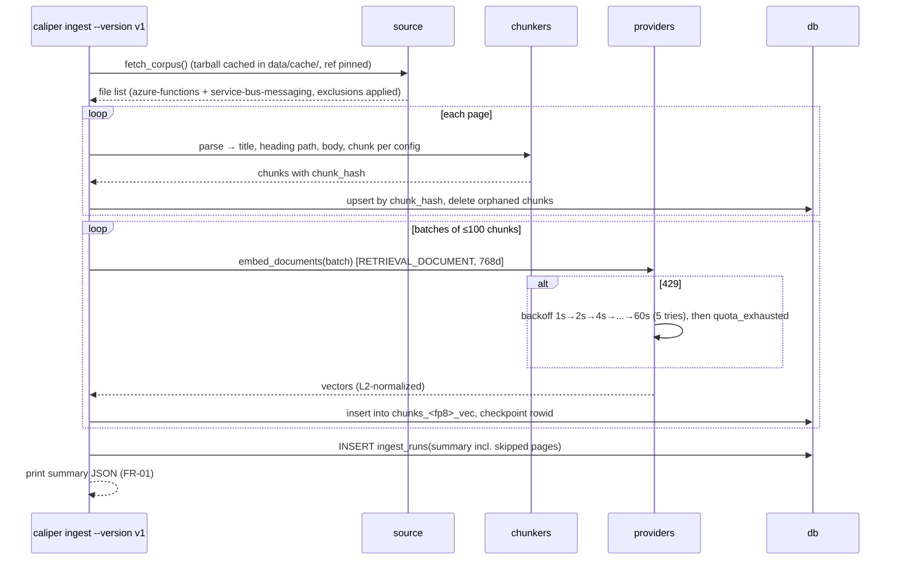

# ARCHITECTURE — Caliper

Source of truth for WHAT: `docs/PRD.md`. This document decides HOW. It is binding on all agents; changes go through the shared-file protocol (Section 14.4).

---

## 1. Overview

Caliper is a local, single-user question-answering assistant over one frozen public documentation set (Azure Functions + Azure Service Bus, ingested from the `MicrosoftDocs/azure-docs` repository). Every answer cites the exact source page URL and a verbatim quoted passage, unsupported questions are refused instead of guessed, and every change to retrieval behavior is measured on a frozen 60-question golden set with append-only, separately identified evaluation runs (V1 → V2 → V3) published in one comparison table.

**Goals (from PRD):** G1 verifiable answers, G2 honest refusal, G3 demonstrated improvement, G4 effortless adoption.

**Non-goals (from PRD):** model fine-tuning, multi-agent orchestration, accounts/auth/multi-tenancy/hosted deployment, conversation memory, coverage claims beyond the one corpus, UI styling beyond readability, CI-triggered evaluation, automated judging as sole arbiter.

**Architectural principles:**

1. **Boring and local.** One SQLite file, one Python package, no services to run except an optional Ollama. Nothing is added that the PRD does not require.
2. **Everything reconstructable.** Every question's full trace (question, retrieved passage IDs, answer, citations, latency, token counts) is persisted and replayable (NFR-01).
3. **Measurement is part of the product.** The eval harness is a first-class component, not a script; runs are append-only and fingerprints are verified, not just recorded (NFR-02, FR-09, FR-10).
4. **Fixed answerer, variable retrieval.** The answering model, prompt template, and generation parameters are identical across V1–V3 and pinned by fingerprint; only segmentation/ranking config varies (FR-10).
5. **Citations are verified, not trusted.** A quote is only surfaced if it is an exact substring of the stored chunk body (FR-04).
6. **Fail loudly and clearly.** Provider mismatches, quota exhaustion, and ungroundable questions produce explicit refusals or errors, never silent degradation (NFR-05).

---

## 2. Requirements Traceability

| Requirement | Component(s) | Section(s) |
|---|---|---|
| FR-01 Documentation ingestion | `ingest` | §7.4, §8, §9.4, §10.3 |
| FR-02 Repeatable indexing, ≥2 segmentation configs | `ingest`, `config` | §7.2, §7.4, §8.3, §9.4 |
| FR-03 Question submission & grounded answer | `web`, `answer`, `cli` | §7.6, §7.7, §9.2, §10.1 |
| FR-04 Source citations (verbatim, multi-passage) | `answer` | §7.7, §9.2, §10.1 |
| FR-05 Refusal of unsupported questions | `answer` | §7.7, §10.1, §11.7 |
| FR-06 Ranking to fixed final set (5) | `retrieval` | §7.5, §9.3 |
| FR-07 Request logging | `logs` (in `db`), all callers | §7.3, §8, §11.3 |
| FR-08 Frozen 60-question golden set | `golden` loader (in `eval`) | §7.8, §8.6, §9.5 |
| FR-09 Evaluation harness, append-only runs | `eval` | §7.8, §9.6, §10.2 |
| FR-10 Three versions, comparison table | `eval`, `config` | §7.2, §7.8, §9.7, §10.2 |
| FR-11 One-command reproducible setup | `cli` (`setup`), `docs/SETUP.md` | §7.7, §9.1, §13 |
| FR-12 Review screen | `web` | §7.6, §9.2, §12 |
| FR-13 Feedback capture and export | `web`, `db` | §7.6, §8.8, §9.2 |
| FR-14 Per-run cost/latency summary | `eval` | §7.8, §9.6 (delivered in P3, not cut) |
| NFR-01 Traceability/auditability | `db` (`requests`, `request_citations`, `request_retrievals`) | §7.3, §8, §11.3 |
| NFR-02 Evaluation integrity | `db` triggers, golden hash check | §8.9, §9.5, §10.2 |
| NFR-03 Performance measurement | `eval` | §7.8, §9.6 |
| NFR-04 Verifiability/usability | `answer`, `web`, `docs/SETUP.md` | §7.7, §12, §13 |
| NFR-05 Graceful failure | `answer`, `web`, `cli` | §11.5, §11.7 |
| NFR-06 Licensing compliance | `ingest`, repo `.gitignore` contract | §7.4, §6.3, §11.6 |
| NFR-07 Single-user local access | `web` (localhost bind), no auth | §7.6, §11.1 |

---

## 3. Assumptions and Open Questions

### Assumptions

1. **A1 — `MicrosoftDocs/azure-docs` layout holds.** Azure Functions articles live at `articles/azure-functions/*.md` and Service Bus articles at `articles/service-bus-messaging/*.md`, mapping to URLs `https://learn.microsoft.com/en-us/azure/azure-functions/<slug>` and `.../azure/service-bus-messaging/<slug>`. Impact if wrong: switch to the documented fallback (Learn TOC API + polite fetch, §7.4); ingestion module isolates this behind one function.
2. **A2 — Gemini free tier remains available through Dec 2026** at roughly the current limits (answer model: RPD ≈ 500; embeddings: 100 RPM / 30k TPM / 1,000 RPD). Impact if wrong: flip `CALIPER_PROVIDER=ollama`; the schema, retrieval, and eval code are provider-agnostic; eval runs simply take longer and cost stays $0.
3. **A3 — Price table figures are as published in Nov 2026** and are stored in one JSON file with an `as_of` date. Real costs are always recomputable from logged token counts (§11.3), so a wrong price figure never invalidates results.
4. **A4 — The golden set is authored by the project owner in week 1** (PRD assumption); the loader validates composition (40/10/10) and hash rather than generating questions.
5. **A5 — Work cadence ≈ 10 h/week.** Phases are sized so each is ~1–2 weeks; the stretch items have a defined cut order (§14.1).

### Open Questions

1. **OQ1 — Exact free-tier RPD for the pinned answer model.** The published table (Nov 2026) lists `gemini-3.5-flash-lite` and `gemini-3.1-flash-lite` at RPD 500 and Flash/Pro models at RPD 20, but Google no longer guarantees the published table's completeness. **Default:** pin `gemini-3.5-flash-lite`; the P0 smoke test (T04) verifies RPD live and, if it is materially below 60, demotes the pin to `gemini-3.1-flash-lite` (same RPD, older generation) or schedules eval runs across days. Recorded in the decision log.
2. **OQ2 — Flash-Lite answer/citation quality.** If V1 spot-checks show citation-quality failures attributable to the model, escalate to `gemini-3.6-flash` (free tier RPD 20 → eval runs must be split across ~3 days). **Default:** stay on Flash-Lite; escalate only on evidence from the V1 spot-check.
3. **OQ3 — Final corpus scope.** All top-level `articles/azure-functions/*.md` (~200 pages) plus all `articles/service-bus-messaging/*.md` (~100 pages), excluding `includes/` directories and files beginning with `_`. **Default:** both folders, exclusions as stated; the ingestion summary (FR-01) reports counts and the owner confirms at the P1 milestone.

---

## 4. System Context and High-Level Architecture

### 4.1 System context



### 4.2 Internal components



Dependency direction (acyclic): `config` and `db` are leaves. `providers → config`; `ingest → providers, db`; `retrieval → db, providers`; `answer → retrieval, providers, db`; `eval → answer, db`; `web → answer, db`; `cli → all of the above`. Nothing ever imports "upward" against these arrows.

### 4.3 End-to-end walkthrough (one question)

A user runs `caliper ask "How do I configure retries on an Azure Functions timer trigger?"`. The CLI loads the active config preset, resolves its fingerprint, and opens the SQLite DB. `answer` asks `retrieval` for the top 5 passages: the question is embedded (`providers`, 768-dim), brute-force KNN runs against the `vec0` table, FTS5 keyword search may be fused in (V3), and the ranked 5 passages are returned with scores. `answer` builds the fixed prompt, calls the chat backend, parses the structured reply (answer text, citations as chunk IDs + quoted spans, or a refusal), verifies each quote is an exact substring of its stored chunk body (retry once on failure), computes the confidence flag, and writes the full trace — question, retrieved chunk IDs with scores, citations, latency, token counts, estimated cost — into `requests`/`request_retrievals`/`request_citations`. The CLI prints the answer with citations; the user clicks a cited URL and finds the quoted passage on the page.

---

## 5. Technology Stack

| Layer | Choice | Version | Rationale |
|---|---|---|---|
| Language | Python | 3.12 (`.python-version`) | One runtime for CLI, eval, web; best RAG ecosystem |
| Package manager | uv | latest stable, `uv.lock` committed | One-command reproducible env (FR-11) |
| LLM provider SDK | `google-genai` | `~=1.0` (pin exact in `uv.lock`) | Current SDK (not the deprecated `google-generativeai`); batch embed support |
| Default chat model | `gemini-3.5-flash-lite` | pinned string in config | Free tier RPD 500 fits a 60-question eval; Flash/Pro are RPD 20 (too low) |
| Fallback chat model | `gemini-3.1-flash-lite` | pinned string | Same free-tier RPD class; used if OQ1 verification demotes the primary |
| Embeddings | `gemini-embedding-001` @ `output_dimensionality=768` | pinned string | `text-embedding-004` retired 2026-01-14; 768 dims = small DB + dimension-compatible with the Ollama fallback |
| Local fallback | Ollama `qwen2.5:7b-instruct` + `nomic-embed-text` (768 dims) | latest via installer | $0 path when the Gemini key/quota is unavailable |
| Vector search | `sqlite-vec` | `==0.1.9` | Pure-C SQLite extension, Windows wheel, brute-force KNN is stable (ANN indexes are alpha — we do not use them) |
| Full-text search | SQLite FTS5 | built into stdlib `sqlite3` | BM25 for the V3 hybrid axis; zero deps |
| CLI | `typer` | `>=0.12` | Subcommand-per-requirement mapping, typed |
| Web | `fastapi` + `uvicorn` + `jinja2` | fastapi `>=0.115` | 2 pages + 4 routes; no build step (FR-11) |
| Reranker (V3 only) | `sentence-transformers` CrossEncoder `cross-encoder/ms-marco-MiniLM-L-6-v2` | `>=3.0`, optional dependency group `rerank` | Local, deterministic, $0; keeps the answerer fixed (a second API call would not) |
| Validation/models | `pydantic` | `>=2.7` | Config + API schemas, fingerprint canonicalization |
| Vector math | `numpy` | `>=1.26` | L2 normalization, RRF, percentile math |
| HTTP | `httpx` | `>=0.27` | Tarball download (one bulk fetch) |
| Test | `pytest` | `>=8.0` | Unit + integration; fixtures, not mocks-by-patch |
| Lint/format/type | `ruff` (lint+format), `mypy` | ruff latest, mypy `>=1.10` | One tool each; CI-enforced |
| CI | GitHub Actions | — | lint + type + test on every push |

**Rejected alternatives (major choices):**

- **Chroma / Qdrant / FAISS server** — extra service or heavier dep for a single-user local tool; SQLite already provides the tables, FTS, and durability.
- **Scraping learn.microsoft.com** — heavy HTML, rate limits, fragile TOC; the GitHub tarball is one clean bulk fetch of the same markdown (§7.4).
- **OpenRouter / NVIDIA NIM as primary** — model churn breaks the "answering component fixed across versions" invariant (FR-10); NIM credits can expire mid-project. Both remain usable through the provider interface if ever needed, but are not configured.
- **LangChain / LlamaIndex** — the retrieval logic *is* the product under test; a framework would hide exactly what we must measure and vary (FR-02, FR-06, FR-10).
- **React/Next/Vite frontend** — build step conflicts with one-command local setup (FR-11); Jinja2 + one JS file suffices for 2 pages.
- **Postgres** — network service for zero multi-user benefit (NFR-07).

---

## 6. Repository Structure

### 6.1 Directory tree

```
caliper/
├── pyproject.toml              # deps, [project.scripts] caliper, optional group "rerank"
├── uv.lock                     # locked, committed
├── .python-version             # 3.12
├── .gitignore                  # data/*.db, data/cache/, caliper.toml, .venv
├── .env.example                # GEMINI_API_KEY placeholder
├── README.md                   # points to docs/SETUP.md
├── ARCHITECTURE.md             # this file
├── caliper.toml                # user config (gitignored), copied from sample
├── configs/
│   ├── caliper.sample.toml     # FR-11 sample configuration template (committed)
│   ├── v1.toml                 # baseline preset (committed)
│   ├── v2.toml                 # improved segmentation preset (committed)
│   └── v3.toml                 # improved retrieval/ranking preset (committed)
├── data/
│   ├── golden/
│   │   ├── questions.jsonl     # frozen 60 questions (committed; the only corpus-derived artifact in git)
│   │   └── GOLDEN.md           # construction rules + freeze statement (committed)
│   ├── cache/                  # azure-docs tarball + extracted tree (gitignored)
│   └── caliper.db              # the single SQLite file (gitignored)
├── docs/
│   ├── PRD.md                  # source of truth (committed)
│   ├── SETUP.md                # FR-11 setup documentation (committed)
│   ├── EVALUATION.md           # comparison table + report fragments (committed)
│   └── LIMITATIONS.md          # known limitations + future enhancements (committed)
├── src/caliper/
│   ├── __init__.py
│   ├── config.py               # config loading, resolution, fingerprint (single definition)
│   ├── schema.sql              # all DDL incl. triggers
│   ├── db.py                   # connection, migrations, typed accessors, append-only helpers
│   ├── providers/
│   │   ├── __init__.py         # get_chat() / get_embeddings() factory
│   │   ├── base.py             # ChatBackend / EmbeddingBackend protocols, ChatResult, Usage
│   │   ├── gemini.py           # google-genai chat + batched embed, 429 backoff
│   │   ├── ollama.py           # local fallback
│   │   └── prices.json         # {as_of, model: {input_per_mtok, output_per_mtok, embed_per_mtok}}
│   ├── ingest/
│   │   ├── __init__.py         # run_ingest() orchestration + summary
│   │   ├── source.py           # tarball download/cache, file→URL mapping, ref pinning
│   │   ├── parse.py            # markdown → page title, heading path, cleaned body
│   │   └── chunkers.py         # v1 heading-chunker, v2 fixed-chunker
│   ├── retrieval/
│   │   ├── __init__.py         # retrieve(question, fingerprint, config) → list[Passage]
│   │   └── fuse.py             # RRF fusion of vector + FTS lists
│   ├── answer/
│   │   ├── __init__.py         # answer_question() end-to-end
│   │   ├── prompt.py           # fixed prompt template (stored as file prompt_template.md)
│   │   ├── quotes.py           # verify_quotes()
│   │   └── confidence.py       # confidence flag rules
│   ├── eval/
│   │   ├── __init__.py         # run_eval() harness
│   │   ├── golden.py           # load + validate golden set (hash, composition)
│   │   ├── metrics.py          # hit rate, citation accuracy, refusal accuracy, median/p95
│   │   ├── spotcheck.py        # sample selection + CLI judgment loop
│   │   └── report.py           # Markdown fragment generation → docs/EVALUATION.md
│   ├── web/
│   │   ├── __init__.py         # FastAPI app factory
│   │   ├── routes.py           # 4 routes
│   │   ├── templates/          # base.html, ask.html, review.html
│   │   └── static/app.js       # fetch calls, no framework
│   └── cli.py                  # typer app: setup, ingest, ask, eval, spotcheck, report, serve
└── tests/
    ├── fixtures/mini-corpus/   # 6 small markdown files for offline ingestion tests
    ├── fakes.py                # FakeChat / FakeEmbeddings backends (no network)
    ├── unit/                   # test_<module>.py per module
    └── integration/            # ingest→ask end-to-end on mini-corpus; eval on fake golden set
```

### 6.2 Naming conventions

- Python modules/packages: `snake_case`. Classes/types: `PascalCase`. Functions/variables: `snake_case`. Constants: `UPPER_SNAKE`.
- DB tables: plural `snake_case` (`requests`, `run_results`); per-fingerprint tables carry the suffix `_<fp8>` (first 8 hex chars of the fingerprint), e.g. `chunks_a1b2c3d4`. Columns: `snake_case`.
- Config keys: `snake_case` in TOML. CLI subcommands: single lowercase words (`setup`, `ingest`, `ask`, `eval`, `spotcheck`, `report`, `serve`).
- Test files: `test_<module>.py`, test functions `test_<behavior>`.
- Commit messages: Conventional Commits (`feat(ingest): ...`).

### 6.3 Ownership and shared files

- Each component owns its directory under `src/caliper/` and its tests under `tests/unit/`.
- **Shared, single-owner files** (changed only by the owning task, through the §14.4 protocol): `src/caliper/config.py` (owner: T02), `src/caliper/schema.sql` + `src/caliper/db.py` (owner: T03), `src/caliper/providers/base.py` (owner: T04), `docs/EVALUATION.md` (owner: T19; appended by `caliper report` only).
- `data/golden/questions.jsonl` is frozen: after the first measured run it is never edited (NFR-02); git history is the immutability record.
- `data/caliper.db`, `data/cache/`, and `caliper.toml` are **never committed** (NFR-06 — derived corpus data and local config stay out of the repo).

---

## 7. Components and Modules

### 7.1 `config` — configuration and fingerprinting

- **Responsibility:** load the user config + a version preset, resolve every field to a concrete value, and compute the single canonical fingerprint used everywhere.
- **Owns:** `src/caliper/config.py`, `configs/*.toml` (contents are data, format owned here).
- **Public interface:** `load_config(user_path: Path, preset: Path) -> CaliperConfig`; `fingerprint(cfg: CaliperConfig) -> str` (SHA-256 of canonical JSON of §7.2's listed fields); `fp8(cfg) -> str`.
- **Depends on:** nothing (leaf).
- **Must not:** perform I/O beyond reading TOML; contain any knowledge of DB layout or providers.
- **PRD requirements covered:** FR-02, FR-10, FR-11.

### 7.2 `providers` — model backends

- **Responsibility:** expose exactly two interchangeable backends (Gemini free tier, Ollama) behind narrow protocols, handle batching, retries with exponential backoff on HTTP 429, usage capture, and cost estimation.
- **Owns:** `src/caliper/providers/`.
- **Public interface:**

```python
class ChatBackend(Protocol):
    def complete(self, *, system: str, user: str, model: str,
                 temperature: float, seed: int | None) -> ChatResult
        # ChatResult: text: str, prompt_tokens: int, completion_tokens: int, model: str

class EmbeddingBackend(Protocol):
    def embed_documents(self, texts: list[str]) -> list[list[float]]  # batched, RETRIEVAL_DOCUMENT
    def embed_query(self, text: str) -> list[float]                   # RETRIEVAL_QUERY

get_chat(cfg) -> ChatBackend; get_embeddings(cfg) -> EmbeddingBackend
estimate_cost(usage, model, prices) -> float  # (prompt*in + completion*out + embed*embed)/1e6
```

- **Depends on:** `config`.
- **Must not:** know about SQLite, prompts, or retrieval; cache results; silently swallow rate-limit errors beyond the bounded backoff (max 5 retries, then raise `ProviderError`).
- **PRD requirements covered:** FR-03, FR-06, FR-07 (usage data), NFR-03, A2/OQ1.

Implementation notes (binding):
- Gemini embeddings: `gemini-embedding-001`, `output_dimensionality=768`, task type `RETRIEVAL_DOCUMENT` for chunks / `RETRIEVAL_QUERY` for questions; **all 768-dim vectors are L2-normalized client-side before storage or comparison** (only 3072-dim output is API-normalized). Batch `embed_documents` at up to 100 texts per request.
- Ollama: `nomic-embed-text` (768 dims) and `qwen2.5:7b-instruct`; same normalization; same protocol.
- Free-tier pacing: callers must assume ≈10 RPM on chat and 100 RPM on embeddings; `providers` enforces no pacing itself but never issues parallel requests (single-threaded call sites).

### 7.3 `db` + `logs` — storage and request traces

- **Responsibility:** own the single SQLite file: connection setup with `sqlite-vec` loaded, schema creation/migration, typed accessors for every table, and the append-only enforcement.
- **Owns:** `src/caliper/schema.sql`, `src/caliper/db.py`.
- **Public interface:** `connect(path) -> sqlite3.Connection` (loads `sqlite_vec`, `PRAGMA journal_mode=WAL`, foreign keys on); `ensure_schema(conn)`; accessor functions per table (`insert_request`, `insert_citations`, `insert_retrievals`, `create_run`, `insert_run_results`, `insert_spot_check`, `insert_feedback`, `get_request_trace`, `list_runs`, ...).
- **Depends on:** nothing (leaf); `sqlite-vec` pip package.
- **Must not:** contain business logic (no ranking, no prompt building); never issue UPDATE or DELETE against `run_results`, `spot_checks`, `feedback`, or against a `runs` row already in a terminal state (schema triggers hard-block it, §8.9).
- **PRD requirements covered:** FR-07, FR-09, FR-13, NFR-01, NFR-02.

### 7.4 `ingest` — corpus fetch, parse, chunk, index

- **Responsibility:** fetch the frozen corpus once, parse pages into (URL, heading path, body), chunk per the active config, embed in batches, write idempotent per-fingerprint index tables, and report a summary including skipped pages.
- **Owns:** `src/caliper/ingest/`.
- **Public interface:** `run_ingest(cfg) -> IngestSummary` (pages_ok, pages_skipped with reasons, chunks_written, chunks_removed, embed_requests, elapsed_s); `fetch_corpus(cfg) -> Path` (tarball download + cache + pinned ref); `page_to_url(rel_path) -> str`; `make_chunker(cfg) -> Chunker`.
- **Depends on:** `providers`, `db`, `config`.
- **Must not:** touch `requests`/`runs` tables; modify or redistribute corpus files (cache only, NFR-06); scrape learn.microsoft.com (fallback TOC-API crawler only if A1 fails, behind `source.py`'s single seam).
- **PRD requirements covered:** FR-01, FR-02, NFR-06.

Implementation notes (binding):
- Source: `https://github.com/MicrosoftDocs/azure-docs` tarball at a **pinned ref recorded at first ingest** (`source_ref` in `ingest_runs`). Read `articles/azure-functions/**.md` and `articles/service-bus-messaging/**.md`, excluding any path containing `/includes/` and files starting with `_`. URL mapping per A1. The tarball is cached in `data/cache/`; re-ingest reuses the cache (no refetch) unless `--refresh` is passed.
- Heading path: first H1 in the file is the page title; the chunk's heading path is `"<page title> > <H2> > <H3>"` as of the chunk's position. Stored on every chunk (FR-01).
- Chunkers (FR-02, ≥2 configs): `heading` (V1) splits at H2 boundaries, merging undersized neighbors up to `max_tokens`; `fixed` (V2/V3) windows the body at `size_tokens` with `overlap_tokens`, prefixing each chunk with `Page: <url>\nHeading: <heading path>`. All chunks cap at 1,900 **estimated** tokens (embedding input limit is 2,048); estimated tokens are `ceil(len(text) / 4)` — the `CHARS_PER_TOKEN = 4` estimator frozen in `chunkers.py` (T06 decision, docs/TASKS.md Notes).
- Idempotency: `chunk_hash = SHA-256(normalized body + url + heading path)` — normalized = LF lines with per-line trailing and outer whitespace stripped, the three fields NUL-separated before hashing (T07 definition, `ingest/__init__.py`) — with a UNIQUE index; re-ingest upserts changed chunks and deletes chunks whose pages disappeared upstream. Index tables are explicitly **not** append-only.
- Embedding quota: batches of ≤100 texts/request; on 429 back off exponentially (1s → 2s → 4s → ... max 60s, 5 tries) and persist a resume checkpoint (last processed chunk rowid) so an interrupted ingest resumes without redoing completed batches.

### 7.5 `retrieval` — search and rank-to-5

- **Responsibility:** turn a question into the final bounded passage set (exactly 5) per the active config's retrieval mode, with observable per-passage scores.
- **Owns:** `src/caliper/retrieval/`.
- **Public interface:** `retrieve(question: str, conn, cfg) -> list[Passage]` where `Passage = (chunk_id, page_url, heading_path, body, score, rank)`; `rrf(vector_list, fts_list, k=60) -> list` in `fuse.py`.
- **Depends on:** `db`, `providers`, `config`.
- **Must not:** call the chat model; alter chunk storage; return more or fewer than `final_k` passages (5) unless the index has fewer rows (then it must say so in `Passage.score` sentinel handling — see §11.5).
- **PRD requirements covered:** FR-03, FR-06, FR-10.

Modes (binding): `mode = "vector"` → cosine KNN top-`final_k` from the `vec0` table (brute force, `MATCH ... AND k = 20` is the stable sqlite-vec path; ANN indexes are not used). `mode = "hybrid_rrf"` → vector KNN top-20 + FTS5 BM25 top-20 fused by RRF (k=60), then optional `rerank = "cross-encoder"` (`cross-encoder/ms-marco-MiniLM-L-6-v2` via the optional `rerank` dependency group) scoring the top-20 pairs and taking top-5. V1 and V2 use `vector`; V3 uses `hybrid_rrf` + rerank (§9.7).

### 7.6 `web` — minimal local UI

- **Responsibility:** serve the ask page, the review screen, and the trace/feedback APIs on localhost only.
- **Owns:** `src/caliper/web/`.
- **Public interface:** the 5 routes in §9.2. Bound to `127.0.0.1` (env-overridable host/port). No authentication (NFR-07).
- **Depends on:** `answer`, `db`, `config`.
- **Must not:** implement ranking/prompt logic (delegates to `answer`); serve any corpus file; bind to a non-loopback interface by default.
- **PRD requirements covered:** FR-03, FR-12, FR-13, NFR-04, NFR-05, NFR-07.

### 7.7 `answer` — grounded answering, citations, refusal

- **Responsibility:** take a question end-to-end: retrieve, prompt the fixed chat model, parse the structured reply, enforce verbatim quotes, compute confidence, refuse when unsupported, and persist the full trace via `db`.
- **Owns:** `src/caliper/answer/` (including `prompt_template.md`, the frozen template text).
- **Public interface:** `answer_question(question: str, conn, cfg, *, run_id: int | None = None) -> AnswerResult` where `AnswerResult` matches the §9.2 response schema plus internal timing/token fields.
- **Depends on:** `retrieval`, `providers`, `db`, `config`.
- **Must not:** use knowledge beyond the retrieved passages; fabricate a citation to fill the schema; change behavior based on `run_id`; call any model other than `cfg.answer.model`.
- **PRD requirements covered:** FR-03, FR-04, FR-05, FR-07, NFR-01, NFR-05.

Binding behaviors:
- **Prompt (frozen):** system prompt instructs: answer only from the numbered passages; if they do not contain the answer, reply with `refused: true` and no speculation; every claim must carry a citation `{chunk: <n>, quote: "<exact contiguous substring of that passage, ≤300 chars>"}`; output strict JSON.
- **Quote verification (`quotes.py`):** normalize whitespace and strip markdown emphasis characters (`*`, `_`, `` ` ``) from both quote and chunk body, then require the normalized quote to be a substring of the normalized body. On failure: retry the model once with a correction message listing the failed quotes. On second failure: drop the failed citation, downgrade confidence, and record `verified=0` in `request_citations`. An answer whose citations all fail keeps `answer_type="answer"` but `confidence="low"` and is flagged in logs.
- **Refusal (two mechanisms):** (1) prompt-anchored (`refused: true` per above); (2) pre-model threshold — if the best `max(cosine score of final 5) < cfg.answer.refusal_threshold`, refuse without a chat call (saves quota, deterministic). The threshold's initial value lives in each preset; it is re-verified once against V1 eval data and then frozen into that version's fingerprint (changing it later starts a new run, per FR-09).
- **Confidence:** `high` = non-refusal with ≥1 verified citation and best final-set cosine ≥ `cfg.answer.high_confidence_threshold`; `medium` = non-refusal with ≥1 verified citation but weaker scores or a dropped citation; `low` = all citations unverified, or refusal produced only by the threshold (not the model).
- **Determinism:** `temperature=0`, `seed` recorded in config; the exact request payload (system+user prompt) is stored in `requests.payload_json` (NFR-01).

### 7.8 `eval` — golden set, harness, metrics, report

- **Responsibility:** validate and load the frozen golden set; run it against a config version as an append-only, separately identified run; compute all metrics including the NFR-03 latency/cost summary; support the manual spot-check; generate the comparison report fragment.
- **Owns:** `src/caliper/eval/`, plus the `docs/EVALUATION.md` generation contract (content written by `report.py`).
- **Public interface:** `load_golden(path) -> list[GoldenQuestion]` (validates SHA-256 against the value recorded in `data/golden/GOLDEN.md`, composition 40/10/10, unique IDs); `run_eval(cfg, version_label) -> run_id`; `compute_metrics(conn, run_id) -> RunMetrics`; `select_spot_sample(conn, run_id, n=20, seed) -> list[qid]`; `record_spot_check(conn, run_id, qid, verdict, note)`; `render_report(conn, run_ids) -> str`.
- **Depends on:** `answer`, `db`, `config`.
- **Must not:** edit `questions.jsonl`; UPDATE any run row; judge answers automatically as the sole arbiter (auto-judgment, if any, is reported alongside, never instead of, the manual sample); run with a stale fingerprint.
- **PRD requirements covered:** FR-08, FR-09, FR-10, FR-14, NFR-02, NFR-03.

Fingerprint gate (binding): before a run starts, `run_eval` recomputes the fingerprint from the resolved config and compares it with (a) the fingerprint stored for the version's index tables and (b) the fingerprint recorded in each question's `run_results` from the previous run of the same version label. On mismatch the run **fails with a clear error** (model swap / config drift would silently break FR-10 comparability).

### 7.9 `cli` — command surface

- **Responsibility:** expose the seven subcommands and wire them to components; the only place argument parsing lives.
- **Owns:** `src/caliper/cli.py`.
- **Public interface:** `caliper setup [--config caliper.toml] [--version v1]`; `caliper ingest --version v1`; `caliper ask "<question>" [--version v1]`; `caliper eval --version v1`; `caliper spotcheck --run <id>`; `caliper report --runs v1 v2 v3`; `caliper serve [--version v1]`.
- **Depends on:** all components.
- **Must not:** contain business logic.
- **PRD requirements covered:** FR-01, FR-03, FR-09, FR-10, FR-11.

### 7.10 Component summary table

| Component | Depends on | Must not | PRD reqs |
|---|---|---|---|
| `config` | — | I/O beyond TOML | FR-02, FR-10, FR-11 |
| `providers` | config | DB/prompts; unbounded retries | FR-03, FR-06, FR-07, NFR-03 |
| `db`+`logs` | — | business logic; UPDATE/DELETE on protected tables | FR-07, FR-09, FR-13, NFR-01, NFR-02 |
| `ingest` | providers, db, config | touch runs; redistribute corpus; scrape | FR-01, FR-02, NFR-06 |
| `retrieval` | db, providers, config | chat calls; change storage | FR-03, FR-06, FR-10 |
| `answer` | retrieval, providers, db, config | non-docs knowledge; wrong model | FR-03–05, FR-07, NFR-01, NFR-05 |
| `eval` | answer, db, config | edit golden set; auto-judge as sole arbiter | FR-08–10, FR-14, NFR-02, NFR-03 |
| `web` | answer, db, config | own logic; non-localhost bind | FR-03, FR-12, FR-13, NFR-04/05/07 |
| `cli` | all | business logic | FR-01, FR-03, FR-09–11 |

---

## 8. Data Model

### 8.1 Entity-relationship diagram



(`CHUNKS` denotes the per-fingerprint trio `chunks_<fp8>` + `chunks_<fp8>_fts` + `chunks_<fp8>_vec`.)

### 8.2 `config_fingerprints`

| Column | Type | Notes |
|---|---|---|
| fingerprint | TEXT PK | SHA-256 hex of canonical config JSON |
| config_json | TEXT NOT NULL | full resolved config, replayable |
| created_at | TEXT NOT NULL | ISO-8601 UTC |

Lifecycle: created by `config`/`db` when an ingest or eval first sees a new fingerprint; never updated or deleted.

### 8.3 Per-fingerprint index tables (`<fp8>` = first 8 hex of fingerprint)

`chunks_<fp8>`: `chunk_id INTEGER PRIMARY KEY`, `page_url TEXT NOT NULL`, `heading_path TEXT NOT NULL`, `body TEXT NOT NULL`, `body_tokens INT NOT NULL`, `chunk_hash TEXT NOT NULL UNIQUE` (SHA-256 of normalized body+url+heading), `ordinal INT NOT NULL`.
`chunks_<fp8>_fts`: FTS5 virtual table over `body` (contentless external-content rowid-mapped to `chunk_id`), BM25 ranking.
`chunks_<fp8>_vec`: `vec0` virtual table, `embedding float[768] distance_metric=cosine`, rowid = `chunk_id`.

`ingest_runs`: `ingest_run_id INTEGER PRIMARY KEY`, `fingerprint TEXT NOT NULL`, `source_ref TEXT NOT NULL`, `started_at TEXT`, `finished_at TEXT`, `pages_ok INT`, `pages_skipped INT`, `summary_json TEXT NOT NULL` (skipped page list with reasons per FR-01).

Lifecycle: written/replaced by `ingest` (idempotent upsert, §7.4); inspected by `retrieval`. Not append-only — repeatability (FR-02) requires upsert/delete.

### 8.4 `requests` (every question, interactive or eval-driven)

| Column | Type | Notes |
|---|---|---|
| request_id | INTEGER PK | |
| ts | TEXT NOT NULL | ISO-8601 UTC |
| question | TEXT NOT NULL | |
| fingerprint | TEXT NOT NULL | |
| run_id | INTEGER NULL | set when eval-driven; links FR-07 to FR-09 uniformly |
| answer_type | TEXT NOT NULL | `answer` \| `refusal` |
| answer_text | TEXT NOT NULL | refusal text for refusals |
| confidence | TEXT NOT NULL | `high` \| `medium` \| `low` |
| latency_ms | INTEGER NOT NULL | end-to-end: embed+retrieve+answer |
| prompt_tokens / completion_tokens / embed_tokens | INTEGER NOT NULL | from providers |
| cost_usd | REAL NOT NULL | §11.3 estimator |
| refusal_stage | TEXT NULL | `threshold` \| `model` \| NULL |
| payload_json | TEXT NOT NULL | exact system+user prompt (NFR-01) |

### 8.5 `request_retrievals` and `request_citations`

`request_retrievals`: `request_id`, `ordinal` (1..5), `chunk_id`, `score REAL`, `stage TEXT` (`vector` | `fts` | `rrf` | `rerank`). Full final-set observability for FR-06/FR-09.
`request_citations`: `request_id`, `ordinal`, `chunk_id`, `page_url`, `heading_path`, `quote TEXT`, `verified INTEGER` (0/1). Refusal rows write no citations.

### 8.6 Golden set (file, not table)

`data/golden/questions.jsonl`, one JSON object per line:

```json
{"id": "q001", "category": "single", "question": "How do I set the retry policy for a timer trigger?", "expected_pages": ["https://learn.microsoft.com/en-us/azure/azure-functions/functions-timer"]}
{"id": "q043", "category": "two_page", "question": "...", "expected_pages": ["<url-a>", "<url-b>"]}
{"id": "q053", "category": "unanswerable", "question": "...", "expected_pages": []}
```

`data/golden/GOLDEN.md` records the construction rules, the composition statement (40 single / 10 two-page / 10 unanswerable), and the SHA-256 of `questions.jsonl`. Loader asserts all three (FR-08, acceptance 4). Lifecycle: authored once in week 1; never edited after the first measured run.

### 8.7 `runs` and `run_results`

`runs`: `run_id INTEGER PRIMARY KEY`, `version_label TEXT NOT NULL` (`v1`/`v2`/`v3`), `fingerprint TEXT NOT NULL`, `golden_hash TEXT NOT NULL`, `seed INTEGER NOT NULL` (spot-check sample seed; also logged), `started_at`, `finished_at`, `status TEXT NOT NULL` (`running` → `complete` | `failed`; `running`→terminal is the **only** permitted UPDATE, enforced by the trigger in §8.9), `summary_json TEXT NOT NULL` (all §9.6 metrics).
`run_results`: `run_id`, `question_id`, `answer_type`, `answer_text`, `confidence`, `hit INTEGER` (1 if all expected pages appear in the final 5), `refusal_expected INTEGER`, `latency_ms`, `cost_usd`, `retrieval_json` (the 5 passages with scores).

### 8.8 `spot_checks` and `feedback`

`spot_checks`: `spot_check_id PK`, `run_id`, `question_id`, `verdict TEXT NOT NULL` (`correct` | `incorrect`), `note TEXT`, `judged_at TEXT`, `judge TEXT`. Insert-only; an erroneous judgment is corrected by a new row with a later `judged_at`, and metrics use the latest row per (run_id, question_id).
`feedback`: `feedback_id PK`, `request_id INTEGER NOT NULL UNIQUE` (max one per request; repeat POSTs return the existing row, §9.2), `helpful INTEGER NOT NULL`, `note TEXT NULL`, `created_at TEXT NOT NULL`. Export (FR-13): `caliper report --feedback csv` writes `data/feedback_export.csv` (question, answer, citations, helpful, note) — candidate additions to the golden set are reviewed there, never auto-inserted.

### 8.9 Append-only enforcement and migrations

```sql
CREATE TRIGGER runs_immutable_after_terminal BEFORE UPDATE ON runs
WHEN OLD.status IN ('complete', 'failed')
BEGIN SELECT RAISE(ABORT, 'run is append-only once terminal'); END;
-- identical triggers on run_results, spot_checks, feedback (unconditional: BEFORE UPDATE, no WHEN)
-- plus BEFORE DELETE triggers on the same four tables
```

Explicitly **excluded** from append-only: `chunks_*` (FR-02 repeatability), `requests` and its children (corrective edits to a mis-logged interactive request are permitted; eval runs never touch them — eval writes go to `runs`/`run_results`).

Migration strategy: `schema.sql` is versioned by a single `schema_meta` table (`schema_version INT`); `ensure_schema()` applies idempotent DDL; per-fingerprint tables are created on demand at ingest time. No seed data beyond the golden set file (loaded, not seeded).

Retention/privacy: nothing contains personal data; `requests.payload_json` never includes `GEMINI_API_KEY` or env values. The DB is a local file; `cp data/caliper.db data/backup.db` before risky operations is the documented backup.

---

## 9. API and Interface Contracts

Standard response envelope: handlers return the payload directly; errors use exactly this body (CLI prints it as JSON to stderr; HTTP uses the same body):

```json
{"error": {"code": "provider_unavailable", "message": "Chat backend unreachable after 5 retries"}}
```

Error codes: `config_invalid` (400/exit 2), `index_missing` (409/exit 3 — no chunks for this fingerprint), `provider_unavailable` (503/exit 4), `quota_exhausted` (503/exit 5), `fingerprint_mismatch` (409/exit 6), `not_found` (404/exit 7), `golden_invalid` (409/exit 8).

### 9.1 CLI

| Command | Args | Behavior | Exit codes |
|---|---|---|---|
| `caliper setup` | `--config caliper.toml`, `--version v1` | validates config + provider availability, ingests if the index for that fingerprint is empty, starts `serve` | 0/2/4/5 |
| `caliper ingest` | `--version v1`, `--refresh` | runs ingestion, prints summary JSON incl. skipped pages | 0/4/5 |
| `caliper ask` | `"<question>"`, `--version v1` | answers; prints answer + citations + confidence; JSON via `--json` | 0/3/4/5 |
| `caliper eval` | `--version v1` | runs the golden set, records run, prints metrics JSON | 0/6/8 |
| `caliper spotcheck` | `--run <id>`, `--sample 20` | interactive judgment loop over the sampled questions | 0/7 |
| `caliper report` | `--runs v1 v2 v3`, `--feedback csv` | writes/updates the comparison table in `docs/EVALUATION.md`; feedback export to CSV | 0 |
| `caliper serve` | `--version v1` | starts uvicorn on 127.0.0.1:8000 | 0/4 |

### 9.2 HTTP (FastAPI, localhost only)

Auth: none (NFR-07). Pagination: none (single-user, bounded data). Idempotency: feedback is unique per request.

**POST /api/ask**

```json
// request
{"question": "How do I configure retries on a timer trigger?"}
// 200 response
{"request_id": 123,
 "answer_type": "answer",
 "answer": "Set the retry block in function.json: ...",
 "citations": [
   {"chunk_id": 412, "page_url": "https://learn.microsoft.com/en-us/azure/azure-functions/functions-bindings-timer",
    "heading_path": "Timer trigger > Retry", "quote": "the retry block uses fixedDelay", "verified": true}
 ],
 "confidence": "high", "latency_ms": 1840, "cost_usd": 0.0}
// refusal response: answer_type="refusal", answer="Not found in the docs.", citations=[], confidence from §7.7
```

Errors: 400 `config_invalid` (empty question → also 400), 409 `index_missing`, 503 provider/quota.

**GET /api/requests/{id}** → full trace (NFR-01): the ask response body plus `retrievals` (5 passages: chunk_id, page_url, heading_path, score, stage), `payload_json`, token counts. 404 `not_found`.

**GET /review/{request_id}** → HTML review page: question, answer, cited sources with verified badges, helpful / not-helpful controls (FR-12).

**POST /api/feedback**

```json
// request
{"request_id": 123, "helpful": false, "note": "cited page exists but quote is from the wrong section"}
// 200 (first time) / 200 with existing record (repeat — idempotent)
{"feedback_id": 7, "request_id": 123, "helpful": false, "created_at": "2026-11-20T10:00:00Z"}
```

Errors: 400 on missing fields, 404 on unknown request_id.

**GET /health** → 200 `{"status": "ok", "provider": "gemini", "fingerprint": "<fp8>", "chunks": 3142}`; 503 with the error envelope if the chat backend is unreachable.

### 9.3 Retrieval contract (internal)

`retrieve(question, conn, cfg) -> list[Passage]` returns exactly `cfg.retrieval.final_k` (5) passages sorted by descending relevance, each with `score` (cosine distance in `vector` mode; RRF score in `hybrid_rrf` mode; post-rerank score when rerank is on) and `stage` tag. If the index holds < 5 rows, it returns fewer and the caller refuses (§11.5). No endpoint or schema deviates from this; changes require updating this section in the same PR (§14.4).

### 9.4 Ingestion summary contract (internal, printed by `caliper ingest`)

```json
{"fingerprint": "a1b2c3d4", "source_ref": "main@9f3ab12", "pages_ok": 297, "pages_skipped": 4,
 "skipped": [{"path": "articles/azure-functions/_footer.md", "reason": "excluded-pattern"},
             {"path": "articles/azure-functions/broken.md", "reason": "parse-error: no H1"}],
 "chunks_written": 3108, "chunks_removed": 12, "embed_requests": 34, "elapsed_s": 2140}
```

### 9.5 Golden set contract (internal)

`load_golden` raises `golden_invalid` unless: SHA-256 of `questions.jsonl` equals the hash in `GOLDEN.md`; IDs are unique; composition is exactly 40 `single` + 10 `two_page` + 10 `unanswerable`; every non-unanswerable question has ≥1 `expected_pages` URL; every unanswerable has `expected_pages: []`.

### 9.6 Evaluation run record (internal, stored in `runs.summary_json` and printed)

```json
{"version": "v1", "fingerprint": "a1b2c3d4...", "golden_hash": "c39a...",
 "questions": 60,
 "hit_rate_answerable": 0.74,
 "refusal": {"unanswerable_refused": 7, "unanswerable_total": 10,
             "answerable_not_refused": 48, "answerable_total": 50},
 "citation_accuracy": {"verified_quotes": 91, "total_quotes": 103},
 "answer_correctness": {"sampled": 20, "correct": 15, "source": "spot_check"},
 "latency_ms": {"median": 1900, "p95": 4100},
 "cost_usd": {"median": 0.0, "p95": 0.0},
 "tokens": {"prompt": 61200, "completion": 18400, "embed": 9800}}
```

Per-question rows in `run_results` carry `latency_ms`/`cost_usd`; the median/p95 summary is computed for **every** run (NFR-03), independent of FR-14's stretch status.

### 9.7 Version presets (contents binding)

| Key | v1 | v2 | v3 |
|---|---|---|---|
| `chunking.unit` | `heading` | `fixed` | `fixed` |
| `chunking.size_tokens` | 800 (max) | 350 | 350 |
| `chunking.overlap_tokens` | 0 | 50 | 50 |
| `retrieval.mode` | `vector` | `vector` | `hybrid_rrf` |
| `retrieval.vector_top_k` / `fts_top_k` | 5 / 0 | 5 / 0 | 20 / 20 |
| `retrieval.rrf_k` | n/a | n/a | 60 |
| `retrieval.rerank` | `none` | `none` | `cross-encoder` |
| `retrieval.final_k` | 5 | 5 | 5 |
| `answer.model` | `gemini-3.5-flash-lite` | same | same |
| `answer.temperature` / `seed` | 0 / 42 | same | same |
| `answer.refusal_threshold` | initial 0.35 (re-verified once against V1 data, then frozen) | same | same |
| `embeddings.model` / `dimensions` | `gemini-embedding-001` / 768 | same | same |

All three presets share the identical prompt template file and answer parameters — the FR-10 invariant.

### 9.8 Provider contracts (internal)

`ChatResult` carries `text`, `prompt_tokens`, `completion_tokens`, `model`. `estimate_cost` uses `prices.json` (`as_of` recorded): current entries — `gemini-3.5-flash-lite` input $0.10/M output $0.40/M, `gemini-embedding-001` input $0.15/M — figures are re-verified at the P0 smoke test; free-tier traffic logs $0.00 cost with full token counts, so any price correction recomputes costs from logs without re-running (A3).

---

## 10. Key Flows

### 10.1 Ask (interactive or eval-driven)



Failure paths: provider 429 → backoff ×5 → `quota_exhausted` error to the user (request logged as failed with latency); provider unreachable → `provider_unavailable`; index empty for fingerprint → `index_missing` (CLI/Web tell the user to run ingest). No path produces an ungrounded answer (NFR-05).

### 10.2 Evaluation run



Pacing: 60 chat calls at ~10 RPM ≈ 6–7 min; embeddings for 60 queries are well inside 1,000 RPD. A crash mid-run leaves `status=failed`; the run is never resumed or modified — a new run is started (append-only, NFR-02).

### 10.3 Ingestion



Resume: the persisted checkpoint lets an interrupted ingest skip completed batches (embedding RPD ≈ 1,000; ~3 configs × ~35 batch requests fits, spread over days).

---

## 11. Cross-Cutting Concerns

### 11.1 Authentication and authorization

None, by PRD (NFR-07): single-user, local. The web server binds `127.0.0.1` (env-overridable `CALIPER_HOST`, but `docs/SETUP.md` never instructs binding beyond loopback). No accounts, no tokens, no CORS beyond default (no cross-origin use). Permission matrix: not applicable — single user with full access.

### 11.2 Configuration and secrets

Every environment variable used anywhere:

| Name | Type | Required | Default | Example |
|---|---|---|---|---|
| `GEMINI_API_KEY` | str | required iff provider=gemini | — | `AIza...` |
| `CALIPER_PROVIDER` | enum `gemini`\|`ollama` | no | `gemini` | `ollama` |
| `OLLAMA_BASE_URL` | URL | no | `http://127.0.0.1:11434` | as default |
| `CALIPER_DB` | path | no | `data/caliper.db` | `D:\caliper\data\caliper.db` |
| `CALIPER_CACHE_DIR` | path | no | `data/cache` | as default |
| `CALIPER_CONFIG` | path | no | `configs/caliper.sample.toml` | `caliper.toml` |
| `CALIPER_HOST` | str | no | `127.0.0.1` | as default |
| `CALIPER_PORT` | int | no | `8000` | `8000` |
| `CALIPER_LOG_LEVEL` | enum | no | `INFO` | `DEBUG` |

Secrets: `GEMINI_API_KEY` lives in `.env` (gitignored; `.env.example` documents it). It is never logged, never stored in the DB, never echoed in errors. User config is `caliper.toml` (copied from `configs/caliper.sample.toml`, gitignored); version presets are separate committed files merged over the user config by `config.load_config`. The fingerprint covers the §9.7 binding fields (model IDs, embedding model + dimensions, prompt template text hash, temperature, seed, thresholds, chunking, retrieval mode and k-values) — deliberately excluding paths and the API key.

### 11.3 Error handling and logging conventions

- Errors: typed exceptions per component (`ProviderError`, `GoldenInvalid`, `FingerprintMismatch`, `IndexMissing`), mapped once in `cli`/`web` to the §9 envelope. No bare `except:`; no swallowed exceptions.
- Logging: Python `logging` to stderr, format `%(asctime)s %(levelname)s %(name)s %(message)s`. Levels: DEBUG (chunk hashes, SQL row counts), INFO (command progress), WARNING (skipped page, dropped citation, 429 retry), ERROR (failed run). Machine-readable results are printed as JSON to stdout; human prose to stderr.
- **Never logged:** API keys, full prompt payloads at INFO (they live in `requests.payload_json` by design), user file paths outside the project.
- Cost estimation: `cost_usd = (prompt_tokens·in + completion_tokens·out + embed_tokens·embed) / 1e6` from `prices.json` (§9.8). Free-tier usage logs $0.00 with full token counts (A3).

### 11.4 Validation

- Pydantic models for: `CaliperConfig` (cross-field rules, e.g. `fts_top_k=0` iff mode=`vector`), golden questions (§9.5), HTTP request bodies (question non-empty ≤500 chars; feedback fields), ingest summary.
- Config errors are reported with the exact offending key path before any provider call is made.

### 11.5 Security (relevant threats and mitigations)

| Threat | Mitigation |
|---|---|
| Prompt injection via retrieved docs content | System prompt states passages are data, not instructions; the model may only cite passages and answer from them; quote verification constrains citations to real stored text |
| Secret leakage | Key in `.env` only; excluded from logs, DB, fingerprints, errors (§11.3) |
| Local web exposure | Loopback bind by default; no file serving; Jinja2 autoescape on |
| Unbounded resources | Question length cap (500 chars); final set fixed at 5; batch caps; single-threaded provider calls |
| Corpus drift changing results silently | Source ref pinned per ingest; fingerprint gate on eval (§7.8) |
| Ungrounded output | Two-mechanism refusal + quote verification + confidence downgrade (§7.7) |

Graceful failure (NFR-05): empty retrieval, empty index, provider outage, and quota exhaustion each map to a distinct refusal or the §9 error envelope — never a crash, never a guess.

### 11.6 Performance and scalability

No targets before the baseline (PRD); measured per run (NFR-03). Expected envelope: ~300 pages → ~3,100 chunks → single-file DB well under 100 MB with 768-dim vectors; brute-force KNN over ≤4k vectors is <10 ms; ingest ≈30–45 min per config (embedding TPM-bound), done at most 3 times total; eval run ≈7 min at free-tier pacing. Measures that achieve this: fixed final set of 5, batching, single SQLite file with WAL, no network in the retrieval path beyond one embedding call.

### 11.7 Observability

- `/health` (§9.2) for process + provider + index status.
- Every run's metrics persisted in `runs.summary_json`; every question's full trace in `requests` + children (NFR-01). Debugging workflow: `GET /api/requests/{id}` or `caliper ask --json` reproduces the exact prompt and scores.
- The demonstration requirement (acceptance 11) is served by trace inspection: pick a failed question from `run_results`, open its trace, show retrieval scores + citations.

### 11.8 Accessibility and internationalization

English-only, matching the corpus. Web pages: semantic HTML, labeled form controls, visible focus, sufficient contrast at default browser styles — no styling effort beyond legibility (PRD FR-12).

---

## 12. Frontend Architecture

- **Routing:** FastAPI serves HTML at `/` (ask page) and `/review/{request_id}` (review screen); JSON at the §9.2 API routes. No client-side router.
- **State management:** none server-side beyond the DB; the ask page is stateless (each question stands alone, FR-03); the review page fetches its trace by ID.
- **Data fetching:** one `static/app.js` using `fetch()` against `/api/ask`, `/api/feedback`, `/api/requests/{id}`. No framework, no build step.
- **Component hierarchy (templates):** `base.html` (header + nav) → `ask.html` (`question-form`, `answer-card` with `citation-list` and verified badges, `confidence-chip`, link to review screen) → `review.html` (same answer rendering + `feedback-form` with helpful / not-helpful and a note field).
- **Form handling:** native form submit intercepted in `app.js`; validation errors render the §9 error envelope inline; double-submit disabled while a request is in flight.
- Pages × components: ask page = question-form, answer-card, citation-list, confidence-chip; review page = answer-card, citation-list, feedback-form, trace-table (from `GET /api/requests/{id}`).

---

## 13. Infrastructure and Deployment

- **Environments:** local only. There is no staging or production: the PRD explicitly excludes hosted deployment (Out of scope) and NFR-07 pins single-user local operation. Not applicable beyond local.
- **Run locally (one command, FR-11):**
  1. Install uv (one-time, documented in `docs/SETUP.md`), copy `configs/caliper.sample.toml` → `caliper.toml`, set `CALIPER_PROVIDER` (+ `GEMINI_API_KEY` in `.env`, or install Ollama and pull the two models).
  2. `uv run caliper setup` — validates config/provider, ingests if the index is empty (first run ≈30–45 min), then starts the web app at http://127.0.0.1:8000. `uv run caliper ask "..."` works end to end immediately after.
- **CI/CD:** GitHub Actions on push/PR: (1) `ruff check` + `ruff format --check`, (2) `mypy src/caliper`, (3) `pytest` (unit + integration; integration tests use `tests/fixtures/mini-corpus` and `tests/fakes.py` — no network, no API key in CI). No deployment stage.
- **Rollback:** not applicable as a service (local tool). Data rollback = restore the SQLite file (`cp` backup, §8.9); code rollback = git revert; a changed model/config necessarily produces a new fingerprint and therefore a new index + new eval run, never an overwrite.
- **Infrastructure-as-code:** not applicable — no infrastructure beyond the local filesystem. Reproducibility is carried by `uv.lock` + pinned model IDs + pinned corpus ref instead.

---

## 14. Implementation Plan for AI Agents

### 14.1 Build phases

| Phase | Weeks (≈10h/wk) | Goal | Components | Deliverables | Definition of done |
|---|---|---|---|---|---|
| P0 Foundation | 1–2 | Scaffold + providers proven live | config, db, providers, cli skeleton | T01–T04 | `uv run pytest` green offline; smoke test script proves chat + embed (768d) + 429 backoff against the live provider; OQ1 resolved and recorded |
| P1 Ingestion | 3–4 | Corpus → searchable index | ingest | T05–T08 | Ingest of the real corpus completes twice producing identical chunk counts (FR-02); summary lists skipped pages (FR-01) |
| P2 Ask path | 5–6 | Question → cited answer/refusal | retrieval, answer | T09–T12 | `caliper ask` answers with verified citations and refuses out-of-scope questions (FR-03–07) |
| P3 Evaluation | 7–8 | Golden set + V1 baseline | eval | T13–T16 | Run v1 recorded append-only with all §9.6 metrics incl. NFR-03 summary; spot-check tool works (FR-08/09/14) |
| P4 Versions | 9–10 | V2 + V3 + comparison | config, retrieval, eval | T17–T19 | Three runs on identical fingerprinted golden set; comparison table in `docs/EVALUATION.md` (FR-10) |
| P5 Stretch | 11–12 | FR-12/13 | web | T20–T21 | Review screen + feedback + export; cut order if slipping: FR-13 first, then FR-12 (FR-14 already delivered in P3 and is never cut) |
| P6 Setup & wrap-up | 13 | One-command adoption + demo | cli, docs | T22–T23 | Unaided-setup test passes with `docs/SETUP.md` alone (FR-11); acceptance-criteria test mapping complete |

### 14.2 Task breakdown

| ID | Task | Files (creates/edits) | Deps | Spec | Acceptance criteria |
|---|---|---|---|---|---|
| T01 | Scaffold package | `pyproject.toml`, `uv.lock`, `.python-version`, `.gitignore`, `.env.example`, `src/caliper/__init__.py`, `src/caliper/cli.py` (skeleton), CI workflow | — | §5, §6, §13 | `uv sync && uv run caliper --help` works; ruff+mypy clean; CI green |
| T02 | Config + fingerprint | `src/caliper/config.py`, `configs/caliper.sample.toml`, `configs/v1.toml`, `configs/v2.toml`, `configs/v3.toml` | T01 | §7.1, §9.7, §11.2, §11.4 | Loading merges user+preset; fingerprint is stable across runs on identical inputs and changes for every §7.8-listed field change; invalid config rejected with key path |
| T03 | Schema + db accessors | `src/caliper/schema.sql`, `src/caliper/db.py` | T02 (fingerprint for `<fp8>` naming) | §7.3, §8 | `ensure_schema` idempotent; append-only triggers raise on UPDATE/DELETE of the 4 protected tables; `connect` loads sqlite-vec on Windows; accessors covered by unit tests |
| T04 | Providers + live smoke test | `src/caliper/providers/*`, `scripts/smoke.py`, `tests/fakes.py` | T02 | §7.2, §9.8 | `smoke.py` completes one chat call and one 768-dim embed per backend, demonstrates normalization, logs a 429 backoff; OQ1 verified and decision logged |
| T05 | Corpus source | `src/caliper/ingest/source.py` | T04 | §7.4 | Tarball fetched once, cached, ref pinned; file→URL mapping unit-tested against 5 known pages; exclusions applied |
| T06 | Parsers + chunkers | `src/caliper/ingest/parse.py`, `chunkers.py` | T05 | §7.4, §9.7 | Heading paths correct on fixture corpus; both chunkers hit their token bounds; 1,900-token cap enforced |
| T07 | Ingest orchestration | `src/caliper/ingest/__init__.py`, `cli.py` (ingest command) | T03, T06 | §9.4, §10.3 | Double-ingest on mini-corpus yields identical counts; orphan chunks removed; summary JSON matches contract |
| T08 | Embedding batcher + resume | edits within `src/caliper/ingest/` only | T07 | §7.4, §10.3 | Batch ≤100/request; 429 backoff via providers; interrupt mid-ingest and resume completes without re-embedding finished batches |
| T09 | Retrieval core | `src/caliper/retrieval/__init__.py` | T03, T04 | §7.5, §9.3 | `vector` mode returns exactly 5 passages with cosine scores; deterministic on fixed input |
| T10 | RRF fusion | `src/caliper/retrieval/fuse.py` | T09 | §7.5 | RRF of two ranked lists matches the textbook formula on fixture vectors; `hybrid_rrf` mode wired behind config |
| T11 | Answer + quotes + confidence | `src/caliper/answer/*` | T09 | §7.7, §10.1 | Refusal on out-of-scope fixture question without hallucinated citations; quote verifier passes/retries/drops per spec; confidence rules unit-tested; full trace persisted |
| T12 | Ask CLI + logging | `src/caliper/cli.py` (ask) | T11 | §9.1, §11.3 | `caliper ask --json` matches §9.2 schema; every call writes `requests` + children with latency/tokens/cost |
| T13 | Golden loader | `src/caliper/eval/golden.py`, `data/golden/GOLDEN.md` | T03 | §8.6, §9.5 | Rejects tampered file (hash), wrong composition, duplicate IDs |
| T14 | Eval harness + metrics + report fragment | `src/caliper/eval/__init__.py`, `metrics.py`, `report.py` | T12, T13 | §9.6, §10.2, §14.1 | 60-question fake run on fakes produces all §9.6 metrics incl. median/p95 (NFR-03); fingerprint mismatch aborts before any run row; two runs coexist append-only |
| T15 | Spot-check tooling | `src/caliper/eval/spotcheck.py` | T14 | §8.8 | Deterministic seeded sample of 20 answerable questions; judgments append-only; metrics use latest judgment |
| T16 | V1 baseline run | `docs/EVALUATION.md` (initial), run records in `data/caliper.db` | T08, T14, T15 + real corpus | §14.1 | Run v1 complete with real corpus; refusal threshold re-verified once and frozen into config; results committed |
| T17 | V2 segmentation run | `configs/v2.toml` (edits by T02 owner), re-ingest, run records | T16 | §9.7, §10.2 | v2 index coexists with v1 (per-fingerprint tables); both prior runs' traces still reconstructable (NFR-01) |
| T18 | V3 reranker + run | optional-group deps in `pyproject.toml`, `src/caliper/retrieval/` (rerank wiring), run records | T17 | §7.5, §9.7 | Cross-encoder reranks top-20→5; v3 run recorded; deltas vs v2 visible in metrics |
| T19 | Comparison table | `docs/EVALUATION.md`, `caliper report` | T16–T18 | §9.1, FR-10 | One table with all three runs' metrics incl. version-over-version deltas; generated by command, committed |
| T20 | Ask page | `src/caliper/web/*` (app, routes, templates, `app.js`) | T12 | §9.2, §12 | Browser ask→answer with citations + confidence; refusal path renders; errors render envelope |
| T21 | Review screen + feedback + export | `src/caliper/web/` additions, `caliper report --feedback csv` | T20 | §8.8, §9.2 | Feedback stored (idempotent), visible on review page, CSV export round-trips; FR-13 export reviewed as candidate-golden input |
| T22 | Setup command + docs | `cli.py` (setup, serve), `docs/SETUP.md`, README | T07, T20 | §13, FR-11 | Fresh clone + sample config + one command → working ask end-to-end; docs assume no prior involvement |
| T23 | Acceptance sweep + demo notes | `tests/integration/acceptance*.py`, `docs/LIMITATIONS.md` | T19, T22 | PRD §8 | Automated mapping of acceptance criteria 1–10 to tests (11 = demo); LIMITATIONS.md lists known limitations |

### 14.3 Parallelization map

- **Blockers (foundation, land first):** T01 → T02 → {T03, T04} (T03 and T04 parallel after T02).
- **P1:** T05 → T06 (sequential), then {T07} → {T08}.
- **P2:** T09 → {T10, T11} (parallel — different files), then T12.
- **P3:** {T13, T14} after T12 — T13 (golden loader) and T14 (harness) touch different files and can proceed concurrently once T13's loader contract (§9.5) is agreed; then T15 → T16.
- **P4:** T17 → T18 strictly sequential (same eval pipeline, ordering matters for attribution); T19 after both.
- **P5:** T20 → T21 sequential (same directory).
- **P6:** T22 can start once T07 + T20 exist (runs parallel with P4/P5 tail); T23 last.
- Max useful concurrency: 2 agents (solo-owner cadence at 10h/wk); the file-ownership rules keep them disjoint.

### 14.4 Shared-file protocol

Changes to single-owner files (`config.py`, `schema.sql`, `db.py`, `providers/base.py`, `docs/EVALUATION.md`, `data/golden/questions.jsonl` when applicable) require: (1) a PR touching only that file plus its owner's tests, (2) the same PR updates the binding section of this document (§7–§9) if a contract changes, (3) the PR description names the dependent tasks, and dependents re-run their integration tests before merging. No task ever edits another task's owned file directly.

### 14.5 Integration points

1. **Providers ↔ ingest (T04↔T08):** first real embedding batch into `chunks_<fp8>_vec`; verify dimensions = 768 and normalization; verify resume checkpoint.
2. **Retrieval ↔ answer (T09↔T11):** first end-to-end `answer_question` on the mini-corpus with fakes; verify trace rows.
3. **Harness ↔ answer (T14↔T11):** first fake golden run producing `runs` + `run_results`; verify fingerprint gate blocks a deliberately mismatched config.
4. **Real corpus ↔ eval (T16):** first measured baseline; verify §9.6 metrics and NFR-03 summary from live data.
5. **Web ↔ answer/db (T20):** first browser question round-trip; verify trace and feedback idempotency (T21).

---

## 15. Testing Strategy

- **Pyramid:** (a) unit tests per module in `tests/unit/` (config fingerprinting, chunkers bounds, quote verifier, RRF, metrics math, golden validation, confidence rules, cost estimator) — no network; (b) integration tests in `tests/integration/` running against the mini-corpus fixture and `fakes.py` backends (ingest→retrieval→answer→trace; eval end-to-end on a fake 60-question set; append-only trigger enforcement; idempotent double-ingest); (c) one manual smoke layer: `scripts/smoke.py` (live provider) and the unaided-setup walkthrough (P6) — run by a human, never in CI.
- **Tools/locations/naming:** pytest only; `test_<module>_<behavior>`; fixtures in `tests/fixtures/` (6 markdown files with known headings, plus `fake_golden.jsonl` with the 40/10/10 composition scaled to 6/2/2 for speed).
- **Mocking policy:** the only mocks are the two `fakes.py` backend implementations (scripted chat responses incl. a paraphrased-quote case and a refusal case; deterministic hash-based embeddings). No `patch()` on internals; components are tested through their public interfaces.
- **Coverage:** mandatory before any task is done: its own acceptance criteria pass, plus integration green. Target ≥80% line coverage on `retrieval`, `answer`, `eval`, `config`, `db`; `web` and `cli` covered by integration/smoke.
- **End-to-end scenarios ↔ acceptance criteria:** A1 cited-answer (integration: mini-corpus page → answer cites URL + verified quote), A2 two-page answer (fixture with a two-page question), A3 refusal content (fixture unanswerable), A4 golden composition (loader test), A5 results table (harness test on fake set), A6 three runs coexist (append-only test), A7 trace reconstruction (`GET /api/requests/{id}` test), A8 repeatable ingestion (double-ingest test), A9 one-command setup (manual P6 walkthrough, recorded in `docs/SETUP.md` changelog), A10 stretch delivered-or-cut record (T23 checks `docs/LIMITATIONS.md`), A11 failure-explanation (trace-driven demo, manual).

---

## 16. Coding Standards and Agent Rules

- **Style:** ruff-enforced (line length 100, single quotes off — double quotes, isort). Full type hints; mypy strict on `src/caliper`. No `Any` without a comment justifying it.
- **Errors:** raise typed component exceptions; map to the §9 envelope at the edges only. Never print raw tracebacks to user-facing output (log at DEBUG).
- **Dependencies:** adding a package requires a PR note stating which requirement needs it; nothing beyond the §5 table without updating §5 in the same PR. No new top-level directories without updating §6.
- **Contracts:** no change to §9 contracts without editing §9 in the same PR (shared-file protocol, §14.4). Model IDs, prompt template text, thresholds, and chunking params change only via config presets + a new fingerprint.
- **Immutability:** never UPDATE/DELETE `runs`, `run_results`, `spot_checks`, `feedback`; never edit `data/golden/questions.jsonl` after the first measured run; never commit `data/caliper.db`, `data/cache/`, `caliper.toml`, `.env`.
- **Commits:** Conventional Commits, scope = component (`feat(ingest): ...`, `fix(eval): ...`). One logical change per commit; tests land with the code they cover.
- **Provider discipline:** no parallel provider calls; respect batching (≤100 embeds/request); bounded retries only (5); on quota exhaustion, stop and report — never loop.
- **When the spec is ambiguous:** follow the stated default from §3 (assumptions/open questions) or, if none applies, the smallest choice consistent with the PRD; record the decision in the PR description and, if it changes a contract, in this document; then continue. Do not stop to ask unless a wrong guess would require re-running a measured evaluation.
- **Do not:** write application logic in `cli`/`web`; import across sibling components against §4.2's direction; add abstractions for hypothetical providers/modes; touch another task's owned files.

---

## 17. Risks and Mitigations

| Risk | Likelihood | Impact | Mitigation | Fallback |
|---|---|---|---|---|
| Gemini free-tier answer-model RPD lower than published (OQ1) | Medium | Blocks eval in one sitting | P0 live smoke test verifies before P1; eval paces ≤10 RPM | `gemini-3.1-flash-lite`; or split a run across days (append-only permits it — status per day impossible mid-run, so run the next calendar day as a fresh run) |
| Embedding quota retaliation (RPD stuck at 0 after overuse) | Low–Medium | Re-ingest blocked | Batch (≈35 req/config), checkpoint resume, never blast re-ingests | Switch provider to Ollama; embeddings re-run locally (768 dims match the schema) |
| `sqlite-vec` breaking change (pre-v1) | Medium | Index unreadable after upgrade | Pin `==0.1.9` in `uv.lock`; never casually upgrade; upgrade = new fingerprint + full re-ingest + note in decision log | Vendor the 0.1.9 extension binary in the repo |
| Chat model deprecated mid-project (2026 model churn) | Medium | Eval comparability threatened | Fingerprint gate fails the run instead of silently mixing models (§7.8) | Re-pin model = documented decision-log entry; runs remain append-only; delta tables footnote the model change |
| Quote paraphrasing by the model | High (expected) | Citation accuracy metric drops | `verify_quotes` + retry-once + drop-with-downgrade (§7.7) | Tighter prompt wording; if still failing, V2's smaller chunks shorten quotes and raise verbatim-hit rate |
| Corpus page layout differs between GitHub markdown and rendered page | Medium | Quote "not findable" on the rendered page (NFR-04) | Pin one canonical source for quotes (GitHub markdown), store both URL and source ref; `docs/LIMITATIONS.md` notes it | Fallback to TOC-API + rendered-page ingestion if quotes prove unfound |
| Eval noise at n=60 with generative answers | High | V1→V3 deltas look random | Headline delta metric = retrieval hit rate (deterministic); answer-correctness deltas reported with sample-size caveat (PRD's manual spot-check design already supports this) | Increase spot-check sample within the manual-judging budget |
| Schedule slip (10h/wk) | Medium | Stretch items at risk | FR-14 delivered in P3; cut order FR-13 → FR-12 with dated record per acceptance 10 | All must-haves are P0–P4 and P6; P5 is severable |
| Windows sqlite extension loading quirks | Low | Dev blocker | `sqlite-vec` ships a Windows wheel; `db.connect` tested on Windows in T03 | `pysqlite3` fallback documented in `db.py` docstring |

---

## 18. Decision Log

1. **ADR-001 — Storage: single SQLite file with `sqlite-vec` + FTS5.** Context: single-user local tool, repeatable indexing, logs + runs + feedback in one place. Decision: SQLite (stdlib) + `sqlite-vec==0.1.9` + FTS5. Alternatives: Chroma (extra service), server vector DBs (unjustified), Postgres (no multi-user). Consequences: zero-install; brute-force KNN only (fine ≤4k vectors); per-fingerprint tables for versioned indexes.
2. **ADR-002 — Provider: Gemini free tier default, Ollama fallback.** Context: $0 budget, two backends must share one schema. Decision: `google-genai` SDK, `gemini-3.5-flash-lite` chat, `gemini-embedding-001` @768. Alternatives: OpenRouter (model churn breaks FR-10), NVIDIA NIM (credit expiry), fully-local-first (install friction vs FR-11). Consequences: free-tier quota pacing required; fingerprint gate detects any silent model change.
3. **ADR-003 — Embeddings at 768 dims, L2-normalized client-side.** Context: `text-embedding-004` retired 2026-01-14; only 3072-dim output is API-normalized. Decision: `gemini-embedding-001` with `output_dimensionality=768` + client-side normalization. Alternatives: 3072 (4× storage, no benefit at this scale), Ollama-only (weaker baseline). Consequences: dimension-compatible with `nomic-embed-text` fallback; normalization mandatory and encoded in `providers`.
4. **ADR-004 — Per-fingerprint index tables.** Context: V2/V3 re-segmentation must not destroy V1's reconstructable traces (NFR-01) while FR-02 demands repeatable re-ingestion. Decision: `chunks_<fp8>`/`_fts`/`_vec` per config fingerprint; append-only triggers scoped to runs/results/spot_checks/feedback only. Alternatives: one shared chunk table (breaks reconstruction), separate DB files (fragments logs). Consequences: up to 3 coexisting indexes (~9k chunks total); ingest upserts freely.
5. **ADR-005 — Ingestion from the `azure-docs` GitHub tarball, not scraping.** Context: FR-01 needs URL + heading path; learn.microsoft.com serves heavy HTML. Decision: pinned-ref tarball, repo-relative → URL mapping per A1, excludes `/includes/` and `_`-prefixed files, ref recorded per ingest. Alternatives: HTML scraping (fragile), TOC API (kept as documented fallback). Consequences: one bulk fetch, clean markdown, heading paths derivable; caveat: quotes are canonical to the GitHub markdown (noted in LIMITATIONS).
6. **ADR-006 — V3 reranker is a local cross-encoder.** Context: FR-10 requires measured differences be attributable to retrieval; a second LLM call for reranking would confound the fixed-answerer invariant and burn quota. Decision: `sentence-transformers` CrossEncoder `ms-marco-MiniLM-L-6-v2` as an optional dependency group. Alternatives: Gemini-based rerank (violates isolation), more embeddings (no cross-signal). Consequences: V3 adds one Python dep (optional), ~20 ms/query, fully offline.
7. **ADR-007 — Citations are code-verified verbatim quotes.** Context: FR-04 and acceptance 1 require the quote to appear on the cited page; LLMs paraphrase. Decision: `verify_quotes` normalized-substring check with one retry, then drop + confidence downgrade. Alternatives: trust the model (fails the metric honestly), fuzzy matching (weakens "verbatim"). Consequences: citation accuracy measures the system, not just the model; some citations get dropped.
8. **ADR-008 — Append-only enforced by SQLite triggers.** Context: NFR-02 says no mechanism may silently modify prior results. Decision: BEFORE UPDATE/DELETE triggers on `runs`, `run_results`, `spot_checks`, `feedback`; index tables deliberately excluded (FR-02). Alternatives: convention-only (weaker), file-based runs (no queryability). Consequences: corrections to judgments are new rows; a crashed run stays as `failed` and a new run starts.
9. **ADR-009 — typer + FastAPI/Jinja2, no JS framework.** Context: FR-11 one-command setup, FR-12 readability-only UI. Decision: typer CLI, FastAPI with 2 HTML pages + 4 JSON routes, single `app.js`. Alternatives: CLI-only (weakens FR-12 delivery), React (build step). Consequences: no frontend build; minimal surface.
10. **ADR-010 — Manual spot-checks stored append-only per run.** Context: FR-09's "manually spot-checked sample" needs a home that respects NFR-02. Decision: `spot_checks` table, seeded deterministic sample of 20 answerable questions per run, latest judgment wins for metrics. Alternatives: spreadsheet (no auditability), auto-judge-only (PRD forbids as sole arbiter). Consequences: judgments are auditable and re-runnable.
11. **ADR-011 — V1 uses cosine-only retrieval; hybrid RRF + rerank is V3's improvement axis.** Context: FR-10's V2 = segmentation change only; V3 = retrieval/ranking change. Decision: `retrieval.mode` config field; RRF (k=60) fusing vector + BM25 named as the algorithm. Alternatives: hybrid from V1 (leaves V3 nothing to isolate). Consequences: clean attribution of deltas.
12. **ADR-012 — uv + Python 3.12, src layout, `uv.lock` committed.** Context: FR-11 reproducible setup. Decision: uv-managed env; `[project.scripts] caliper`; `.python-version` pins 3.12. Alternatives: pip+requirements (weaker locking), Poetry (heavier). Consequences: `uv run caliper setup` is the one documented command.
